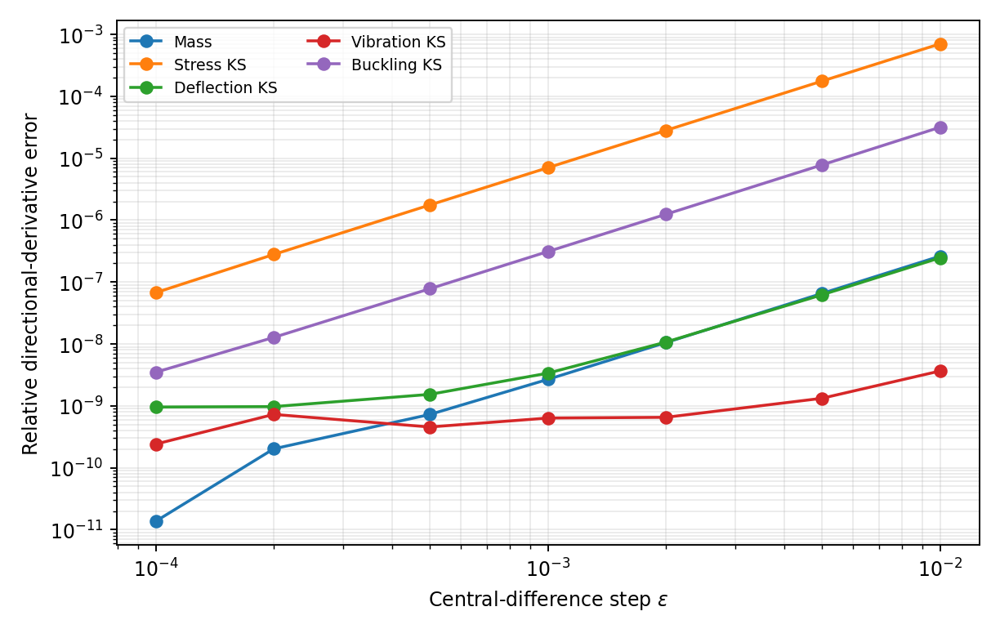
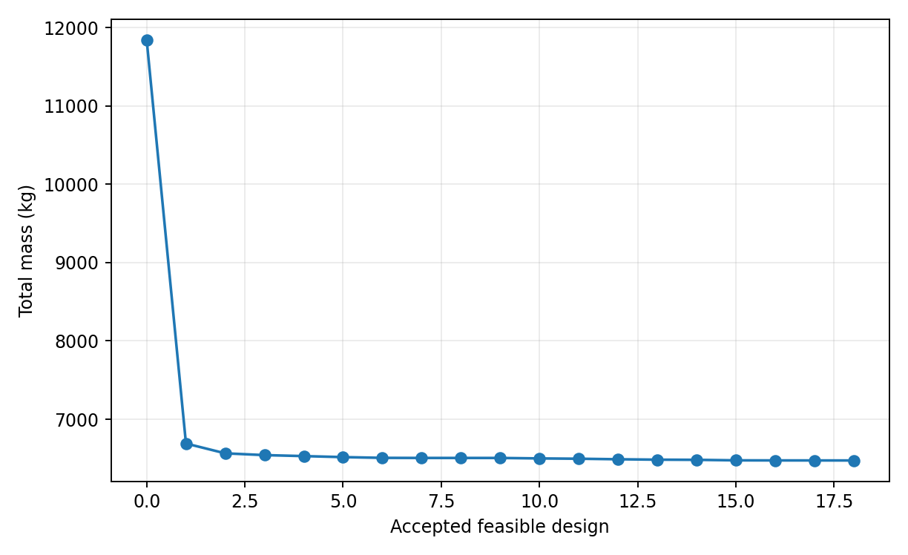
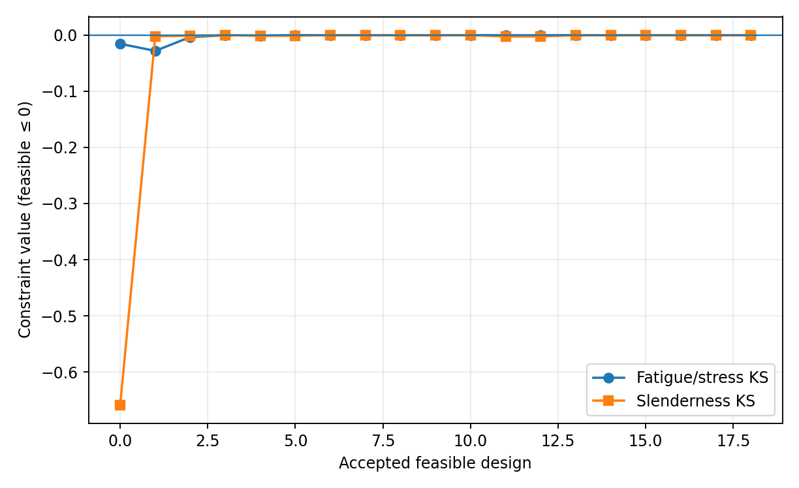

# PDE-Constrained Footbridge Optimization

<p class="lede">We built and verified our own sparse 3D Euler–Bernoulli frame finite-element solver, differentiated its PDE-constrained responses with adjoint and eigenvalue sensitivities, and optimized a 15 m steel footbridge for minimum mass subject to strength, fatigue, deflection, vibration, linear buckling, and member-slenderness requirements.</p>

<div id="headline-result" class="callout">Loading solver-generated headline result…</div>

## Initial vs. optimized design

<div id="viewer-shell" class="viewer-shell">
  <div class="viewer-toolbar">
    <label>Static deformation <input id="deform-scale" type="range" min="0" max="40" step="1" value="15"><span id="deform-scale-label">×15</span></label>
    <label>Member thickness <input id="thickness-scale" type="range" min="0.7" max="2.5" step="0.1" value="1"><span id="thickness-scale-label">×1.0</span></label>
    <label>Animation
      <select id="animation-mode">
        <option value="vibration">Lowest vibration mode</option>
        <option value="buckling">First buckling mode</option>
        <option value="none">None</option>
      </select>
    </label>
    <button id="animation-toggle" type="button">Pause animation</button>
  </div>
  <div id="bridge-viewer" class="viewer-stage">
    <div class="viewer-label left">Initial</div>
    <div class="viewer-label right">Optimized</div>
    <div class="viewer-divider"></div>
    <div class="colorbar-wrap">
      <div><strong>Fatigue stress utilization</strong> (black geometric marker = over limit)</div>
      <div class="colorbar"></div>
      <div class="colorbar-scale"><span>0</span><span>0.5</span><span>1.0+</span></div>
    </div>
    <div id="viewer-tooltip" class="tooltip"></div>
  </div>
  <div class="viewer-note">Drag to orbit; wheel/pinch to zoom; hover a member to inspect it. Member radii are true geometry at thickness ×1. Static deformation uses the FE element's cubic Hermite interpolation. Eigenmodes are normalized for visualization only.</div>
</div>

<div id="metrics-panel" class="metrics-grid"></div>
<script type="module" src="assets/report.js"></script>
<script type="module" src="assets/viewer.js"></script>

## 1. Summary

<div id="result-summary-table">Loading solver-generated comparison…</div>
<div id="result-interpretation"></div>

The design study answers a simple engineering question: **how much steel can be removed from a pedestrian bridge when all member sizes and two global shape variables are changed together, while the complete finite-element model continues to satisfy its performance requirements?** The optimized member distribution is highly nonuniform: highly loaded chords, diagonals, and floor-system members retain material, while lightly loaded bracing and verticals shrink until the slenderness rule becomes active. This is exactly the type of many-variable design problem for which reduced gradients are useful.

## 2. Structure and formulation

### 2.1 Structural concept

The bridge has a 15 m simply supported span and a 3 m deck width. Its structural concept is a 10-panel, three-dimensional Pratt-style frame consisting of two side trusses, floor beams, five longitudinal deck-support lines, top cross-members, and alternating top-plane bracing. Every physical member is a circular hollow section (CHS) with outer radius $r$ and wall thickness $t=r/10$.

<div id="model-optimization-text">Loading solver-generated model summary…</div>

The steel properties are

$$
E=200\ \text{GPa},\qquad \nu=0.3,\qquad \rho=7850\ \text{kg/m}^3,
$$

with $S_y=250$ MPa, $S_{ut}=460$ MPa, and the course-specified fatigue strength $S_f(10^6)=86.2$ MPa. The loading is member self-weight plus an 8 mm steel deck and a 5.0 kPa pedestrian pressure. The deck mass is included in vibration, but pedestrian mass is not.

### 2.2 Design variables and bounds

The full FE model contains 177 physical member radii. Because the geometry and gravity loading are symmetric, mirror-equivalent member sizes are tied only when the transformed physical member actually exists. This leaves **54 independent size groups** plus two shape variables:

- member-group radii: $10\le r\le150$ mm;
- truss depth: $1.0\le H\le4.0$ m;
- parabolic top-chord camber: $0\le c\le1.5$ m.

The top-chord height is

$$
z_{top}(x)=H+4c\frac{x}{L}\left(1-\frac{x}{L}\right).
$$

The objective is total mass,

$$
\min_d\;m(d)=m_{deck}+\rho\sum_m A_m(d)L_m(d),
$$

where $m_{deck}$ is fixed and $A_m=\pi(r_m^2-0.9^2r_m^2)$.

### 2.3 Requirements

| Requirement | Implemented expression | Limit | Limit source |
|---|---|---:|---|
| R1 static strength | $\max\sigma_{vM}$ | $\le160$ MPa | Project 4 specification |
| R2 fatigue | Goodman factor of safety under zero-to-full load | $n_f\ge2$ | Project 4 specification / specified steel S–N data |
| R3 deflection | maximum downward deck displacement | $\le L/400=37.5$ mm | Project 4 specification |
| R4 vibration | lowest natural frequency of **any** mode | $\ge3.0$ Hz | Project 4 specification |
| R5 stability | S1 linear buckling load factor | $\alpha_{cr}\ge3.0$ | Project 4 specification |
| R6 slenderness | $L_m/r_g$ for every member | $\le200$ | AISC 360 recommendation adopted by the Project 4 specification |

For each element end, the recovered CHS stress is

$$
\sigma=\frac{|N|}{A}+\frac{\sqrt{M_y^2+M_z^2}}{I/r},\qquad
\tau=\frac{|T|r}{J},\qquad
\sigma_{vM}=\sqrt{\sigma^2+3\tau^2},
$$

with $I=\frac{\pi}{4}(r^4-r_i^4)$, $J=2I$, and $r_i=0.9r$.

For fatigue, the load cycles from zero to the full design load, so $\sigma_a=\sigma_m=\sigma_{vM}/2$. With $S_e=0.7(86.2)=60.3$ MPa,

$$
n_f=\left(\frac{\sigma_a}{S_e}+\frac{\sigma_m}{S_{ut}}\right)^{-1}.
$$

The required $n_f\ge2$ is equivalent to a peak-stress limit of approximately 53.3 MPa, so R2 is tighter than R1 for this load case.

### 2.4 Deck model

We use deck option D2. The 8 mm plate contributes gravity load and mass but no stiffness. Pedestrian pressure plus deck self-weight is distributed as consistent line loads to five longitudinal support lines with 0.75 m spacing. The plate is checked separately using the required simply supported strip model,

$$
\sigma_{plate}=0.75\frac{q_{tot}s^2}{t^2}.
$$

The initial and optimized bridges share the same deck layout, so this plate check is independent of the member-size optimization.

## 3. Analysis model

### 3.1 Governing equations and discretization

Each frame node has six degrees of freedom: three translations and three rotations. The static state is defined by

$$
K(d)u=F(d),
$$

where both $K$ and $F$ depend on member geometry; $F$ depends on the radii through self-weight. Sparse global matrices are assembled from a from-scratch 3D Euler–Bernoulli beam element. Rigid joints are assumed. Every physical member is divided into two FE elements so member bending and buckling modes can appear.

The vibration problem is

$$
K\phi=\omega^2M\phi,\qquad f=\frac{\omega}{2\pi},
$$

with a consistent member mass matrix and lumped D2 deck mass. R4 uses the lowest frequency without classifying mode direction.

The S1 stability model first solves the static state, recovers element axial forces, assembles the geometric stiffness $K_G(u,d)$, and solves

$$
(K+\alpha K_G)\psi=0.
$$

Numerically we use

$$
(-K_G)\psi=\mu K\psi,\qquad \alpha=\frac1\mu,
$$

so the largest positive $\mu$ gives the smallest positive buckling factor.

### 3.2 Boundary conditions and loads

All deck nodes on the left end line have $u_x=u_y=u_z=0$. All deck nodes on the right end line have $u_y=u_z=0$ while $u_x$ remains free. Rotations are not directly restrained. Member self-weight acts on every beam element, and the D2 deck load is distributed along the five longitudinal support lines using consistent beam load vectors rather than nodal point-load approximations.

### 3.3 Main modeling assumptions

The model assumes linear-elastic steel, small service-load displacement, rigid joints, Euler–Bernoulli beam kinematics, and no transverse shear deformation. Deck stiffness is omitted under D2. The single design load is symmetric gravity loading; wind, asymmetric crowd patterns, joint flexibility, local shell buckling, fabrication tolerances, residual stress, and connection design are outside the model. R5 is a linearized stability calculation about the computed static state rather than a geometrically nonlinear collapse analysis.

## 4. Verification

The solver was treated as untrusted until the verification ladder passed. Closed-form beam tests exercise local stiffness/sign conventions; convergence tests exercise mass and geometric-stiffness formulations; global tests exercise transformations, support conditions, and load assembly; V6 tests the complete reduced-gradient chain.

<div id="verification-summary-table">Loading solver-generated verification table…</div>

The V3 frequency error and V4 Euler-buckling error both decrease rapidly with mesh refinement. The free-free frame has exactly six rigid-body modes. The bridge's generalized vibration and buckling equations also have residuals near machine precision. The D2 deck mass is conserved exactly by the lumping scheme, and the required plate-strip check passes.

A separate distributed-load/stress-recovery benchmark uses a uniformly loaded cantilever. Its tip displacement, root shear, and root bending moment agree with their closed-form values to machine precision. This test was added after verification caught an early modeling mistake in which a distributed load had been approximated too crudely by nodal forces.

## 5. Sensitivity analysis

### 5.1 Static adjoint

For a scalar response $g(d,u)$ with residual

$$
h(d,u)=K(d)u-F(d)=0,
$$

the reduced derivative is evaluated with the adjoint

$$
K^T\lambda=-g_u^T,
$$

followed by

$$
\frac{dg}{dd_j}=g_{d_j}+\lambda^T\left(K_{d_j}u-F_{d_j}\right).
$$

Because the global stiffness is symmetric, the adjoint uses the same reduced stiffness matrix as the forward solve. Stress and deck-deflection aggregates each therefore require one static adjoint solve rather than one perturbed FE solve per design variable.

Member-radius derivatives of section properties, stiffness, mass, and self-weight are analytical and element-local. For the two shape variables, centered differences are used only for **operator partial derivatives at fixed state**. The displacement dependence still passes through the adjoint; no perturbed PDE solve is used to form the reduced shape gradient.

### 5.2 Smooth aggregation

Max-type quantities are replaced during optimization by a conservative Kreisselmeier–Steinhauser aggregate,

$$
KS_\rho(a)=a_{max}+\frac1\rho\ln\sum_i e^{\rho(a_i-a_{max})}.
$$

We use $\rho=60$ for the PDE-based stress, deflection, vibration, and buckling aggregates. Slenderness uses $\rho=300$ because it is an inexpensive explicit constraint and a tighter approximation is practical. The report and viewer always show the **true** maximum/minimum values as well as the smooth optimization constraints.

### 5.3 Eigenvalue sensitivities

For $K\phi=\omega^2M\phi$ with $\phi^TM\phi=1$,

$$
\frac{d(\omega^2)}{dd_j}=\phi^T\left(K_{d_j}-\omega^2M_{d_j}\right)\phi.
$$

The six lowest modes are aggregated so the constraint remains smooth when nearby modes exchange order.

For buckling we use $(-K_G)\psi=\mu K\psi$, $\psi^TK\psi=1$, giving

$$
\frac{d\mu}{dd_j}=\psi^T\left(-\frac{dK_G}{dd_j}-\mu K_{d_j}\right)\psi.
$$

Since $K_G$ depends on static axial forces and therefore on $u(d)$, the buckling aggregate also contains an adjoint-through-state term. All six critical eigenvalue state terms are combined before the adjoint solve, so the aggregate still needs only one static adjoint.

### 5.4 Gradient verification and cost

The V6 test uses a deterministic random direction through the full **179-variable ungrouped design** (177 radii, $H$, and camber), deliberately with nonzero shape components. The reduced directional derivative is compared with a central-difference sweep of the complete FE/eigenvalue analysis.

<div id="gradient-error-table">Loading gradient errors…</div>



The expected $O(\epsilon^2)$ central-difference regime is visible before round-off dominates.

<div id="sensitivity-cost-table">Loading sensitivity timing…</div>

The key scaling advantage is that the reduced-gradient cost depends primarily on the number of scalar outputs, not on the number of sizing variables.

## 6. Optimization

### 6.1 Numerical strategy

All variables are scaled before optimization. The accepted design sequence is:

1. a uniform feasible starting design;
2. a fully stressed warm start;
3. NLopt LD_MMA applied to the governing R2/R3/R6 static constraints using verified reduced gradients;
4. short feasible sequential-linear-programming refinements with move limits;
5. independent full-model R4/R5 reanalysis of the incumbent.

A direct full-physics SLSQP polish was also tested, but its mass reductions came from steps that left the active fatigue/slenderness feasible region. Those iterates were rejected rather than reported.





The accepted history approaches the fatigue and slenderness boundaries from the feasible side. Deflection, vibration, and buckling retain significant margin.

### 6.2 Active constraints and KKT interpretation

The final active set consists of the fatigue/stress KS constraint and the slenderness KS constraint. Negative KS values are feasible; values near zero are active.

<div id="active-constraint-table">Loading final aggregate constraints…</div>

An active-set least-squares multiplier estimate gives:

<div id="kkt-table">Loading KKT diagnostic…</div>

The multiplier units above use the normalized constraints. The fatigue multiplier is much larger, indicating that a small relaxation of the fatigue requirement has much greater mass value than the same normalized relaxation of slenderness. The stationarity residual is not machine zero, so this is reported as an **approximate KKT diagnostic** rather than a proof of exact first-order optimality. Feasibility is tight, there are no lower-bound sign violations in the diagnostic, and an additional short feasible-SLP refinement accepted no further mass-reducing step.

## 7. Nonlinear/stability component

The required beyond-linear component is N1/S1: linear buckling about the **computed stressed state**. Although the eigenproblem itself is linear, its geometric stiffness is built from the static axial forces, so the stability operator depends on the PDE state and its design gradient includes the adjoint term described above.

<div id="r5-comparison">Loading with/without-R5 comparison…</div>

This result is physically plausible: the R6 slenderness rule already prevents the lightly loaded bracing and vertical members from becoming arbitrarily thin, so the global/member instability margin stays well above the explicit R5 requirement.

## 8. Engineering interpretation

The optimization does not simply scale the entire bridge down. It redistributes material according to function. Fatigue governs the members that carry the main gravity-load path, while slenderness sets a minimum practical size for lightly loaded members whose structural role is poorly represented by a single symmetric gravity load. The lowest natural frequency decreases as mass is removed and shape changes, but remains feasible. Buckling also loses margin relative to the uniform baseline yet remains far from active.

The 50 mm initial bridge is a useful demonstration of why feasibility matters: it is lighter than the optimized bridge but fails fatigue badly. The appropriate baseline is therefore the lightest simple uniform design that passes every requirement, not the infeasible starting point.

## 9. Reproducibility

Install the Python dependencies and regenerate the complete site data with:

```bash
pip install -r requirements.txt
python scripts/export_site_results.py
```

That command reanalyzes the initial and optimized bridges, reruns the report verification evidence, regenerates the Taylor/optimization plots, and writes the authoritative `assets/results.json` used by the report and 3D viewer.

The principal verification scripts can also be run independently:

```bash
python verification/run_basic.py
python verification/run_linear_ladder.py
python verification/run_load_recovery.py
python verification/run_bridge_checks.py
python verification/run_eigen_bridge_checks.py
python verification/run_gradients.py
```

In the team repository, GitHub Pages is deployed with the custom `.github/workflows/project4-pages.yml` workflow. The workflow builds the repository's outer `Project4/` directory as the Jekyll source. All site asset paths are relative, and the report and viewer read their numerical state from `assets/results.json`.

## 10. Limitations

This is a design-study model, not a construction-ready bridge design. Important limitations are:

- D2 neglects deck plate stiffness and composite action.
- The service analysis is small-displacement, linear-elastic frame theory.
- Linear buckling does not explicitly model imperfections, plasticity, residual stress, local shell buckling, or connection failure.
- Only the specified symmetric gravity load is optimized; wind, asymmetric crowd loading, impact, seismic loading, and accidental load cases are absent.
- Stress is recovered from beam section forces at element ends; local connection and weld stresses are not resolved.
- Optimization uses symmetry-tied sizing variables and is nonconvex in the shape variables, so the reported design is a locally refined feasible design rather than a certified global optimum.
- Shape operator partials use centered numerical differentiation at fixed state, while state dependence is handled by the adjoint.
- The KKT stationarity diagnostic is approximate, as reported above.

## 11. AI-use statement

Generative AI was used to a very high degree, as encouraged for this project. The AI drafted most of the finite-element implementation, verification harness, sensitivity and optimization code, Three.js viewer, debugging changes, and report text. The student directed the project choices, reviewed milestone outputs, requested an explicit high-level audit before optimization, and used the verification results as the acceptance criterion rather than trusting agent-generated code by inspection.

Verification caught concrete agent/modeling mistakes. In the first simply supported beam setup, an irrelevant torsional rigid mode was left free and the uniform line load was approximated with nodal forces, producing an inaccurate benchmark. The test was corrected to use the consistent Euler–Bernoulli load vector and appropriate support treatment. Later, optimization profiling exposed a wrapper bug that unnecessarily computed full adjoint Jacobians during ordinary line-search value evaluations; that was removed before accepting any optimized design.

The central principle of the AI workflow was therefore: **agent-generated implementation was not accepted because it looked plausible; it was accepted only after analytical, convergence, balance, eigen-residual, and finite-difference gradient checks passed.**

## References

1. Course Project 4 specification, *PDE-Constrained Design Optimization* (provided course handout).
2. AISC 360, *Specification for Structural Steel Buildings*; the project specification adopts the recommended $L/r\le200$ compression-member limit as R6 for every member.
3. Svanberg, K. (1987). “The method of moving asymptotes—a new method for structural optimization.” *International Journal for Numerical Methods in Engineering*, 24(2), 359–373.
4. Seyranian, A. P., Lund, E., & Olhoff, N. (1994). “Multiple eigenvalues in structural optimization problems.” *Structural Optimization*, 8, 207–227.
5. Bruyneel, M., & Duysinx, P. (2005). “Note on topology optimization of continuum structures including self-weight.” *Structural and Multidisciplinary Optimization*, 29, 245–256.
