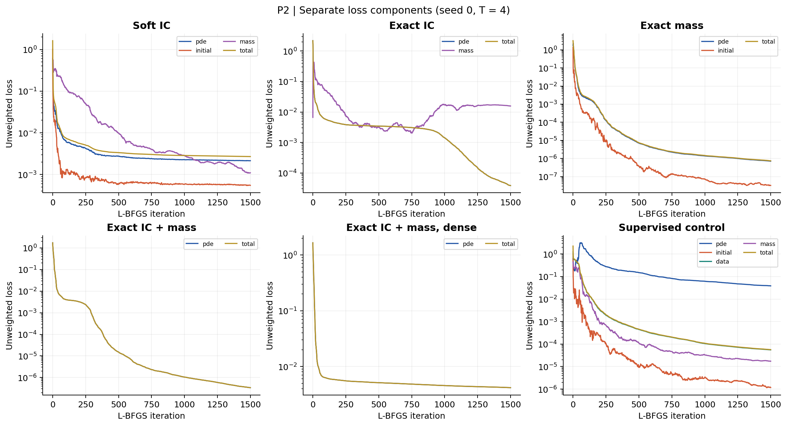
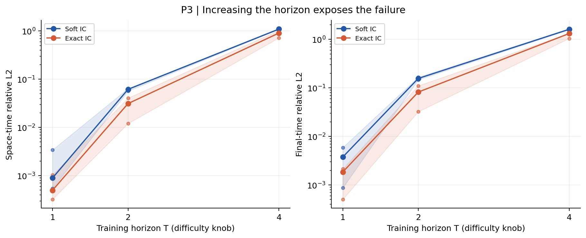
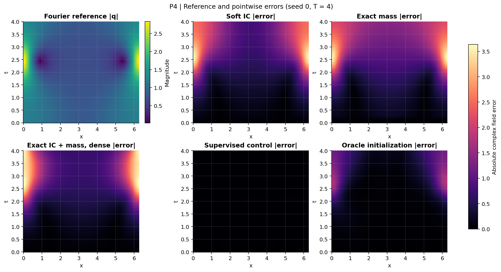
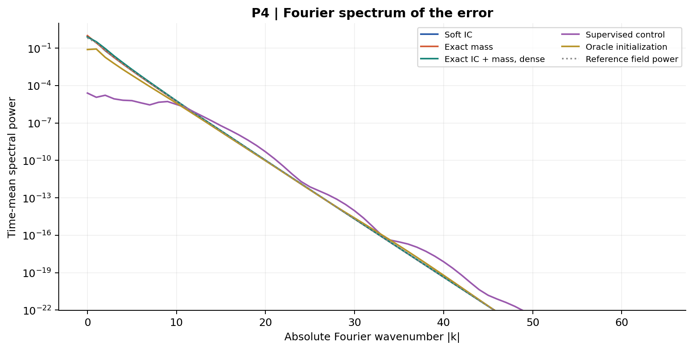

# Project 3: periodic NLS - Path B diagnosis

**Researcher:** Jimmie Adriazola, ASU. **Team:** Ashden; Jack; Josh; Rob; Gabi.  
**Numerical study:** October 20, 2026. **Path:** B; no Path C fix is claimed.

The PINN's median error increases from 0.0896% at T=1 to
110% at T=4. The same network fitted to reference data reaches
0.763% at T=4. This study diagnoses a failure of the tested
physics-only training setup. All 42 runs, code, and data are included.

## 1. Outreach log

| Required item | Record |
| --- | --- |
| Researcher and format | Jimmie Adriazola; written response addressed to Ashden. No live meeting is claimed. |
| Fri, Oct 9, Found through provided list of researchers | COMPLETE: actual contact/response dates and original discovery method. |
| Outcome | He described his current research, concerns about PINNs, and a periodic NLS case to study. Add any other actual outreach attempts. |
| Permission | He allowed named summaries or quotations, provided optimal control is identified as earlier work. |
| Brief review and memo | Brief review is pending; memo has not been recorded as sent. Enter the actual send date and any later response. |

## 2. Problem brief

Jimmie Adriazola's current research focuses on nonlinear waves, integrable and
near-integrable systems, model reduction, and scientific machine learning. He is
interested in which spectral structures survive when integrable systems are
perturbed and whether those structures provide useful coordinates for computation
and learning. PDE-constrained optimal control and his Maxwell work are earlier
research.

His main concern is fidelity over time: small short-time error can grow into
wrong phase, conserved quantities, or coherent structures. This matters when
interpreting nonlinear wave behavior in optical, fluid, and quantum settings.

His projects use different PDEs and a mix of spectral methods, numerical PDE
solvers, symbolic work, and learned models. He did not specify one production
equation, solver runtime, hardware setup, or query count. Standard PINNs are not
a primary tool in his work. He prefers enforcing known constraints directly
when practical and judges accuracy against the application's modeling and
discretization errors.

For this project, he suggested a periodic cubic nonlinear Schrodinger test with
a Fourier reference. We use a nonconstant initial condition and increasing time
horizons to examine phase, mass, Hamiltonian, and solution error. This is our
synthetic case study, not a failed experiment he reported. **Researcher review:
pending.**

## 3. Minimal case formulation

The dimensionless focusing cubic NLS problem is

$$
i q_t+\frac12q_{xx}+|q|^2q=0,\qquad x\in[0,2\pi),\quad t\in[0,T],
$$

$$
q(x,0)=1+0.2\cos x,\quad
q(0,t)=q(2\pi,t),\quad q_x(0,t)=q_x(2\pi,t).
$$

The difficulty knob is **T=1, 2, 4**. Each horizon is a separate full-interval
training problem. The simple periodic geometry removes meshing difficulties
while keeping nonlinear phase evolution and nonconstant wave dynamics.
This is the integrable base equation, not a near-integrable perturbation study.

We measure relative complex-field L2 error and the invariants

$$
M=\int|q|^2dx,\qquad H=\int\left(\frac12|q_x|^2-\frac12|q|^4\right)dx.
$$

The common 794-parameter network has two 24-unit tanh layers and input
(cos x, sin x, cos 2x, sin 2x, 2t/T-1), so periodic boundaries hold exactly.
The default loss is mean squared PDE residual plus initial-condition error.
Controls fit the same network to reference data, then use that fitted network
to initialize physics-only training. A further control normalizes the output
to enforce mass on the 32-point quadrature grid; its time derivative is included
in training. Reported invariant errors use a separate 256-point grid.

## 4. Experiments

**Settings:** float64; seeds 0, 1, 2; 1,500 L-BFGS iterations per optimization;
32 spatial points and 12 sampled times per unit interval. Matched controls share
samples, architecture, and optimizer. The dense control uses 160 times at T=4.
42 of 42 optimizations reach their iteration
limit. The comparison is for this budget, not proven global convergence.
Errors use a common 256-point grid with snapshots every 0.025 time units.

### P1 - Conventional reference

We use a Fourier Strang split-step solver with N=256 and dt=0.0005. Its T=4
wall time is 0.2795 seconds. Refinement checks are below;
differences are empirical accuracy estimates, not rigorous bounds.

| Check | N | dt | Relative L2 difference from reference | Wall seconds |
| --- | --- | --- | --- | --- |
| production | 128 | 0.001 | 9.009e-06 | 0.1005 |
| time_finer | 256 | 0.00025 | 2.252e-06 | 0.5454 |
| space_finer | 512 | 0.0005 | 8.998e-13 | 0.4357 |

The reference plane-wave check has maximum absolute error 2.386e-13.
Reference mass and Hamiltonian defects are 2.822e-13 and
3.696e-06. The cheaper N=128, dt=0.001 baseline takes a median
0.1034 seconds at T=4.

### P2 - Separate losses

PDE, initial, boundary, data, mass, and total losses are logged separately.
Boundary loss is zero by construction. Data loss is inactive in physics-only
training; IC loss is zero for exact-IC models. Zero/inactive curves are omitted
from the log plot but retained in the CSV histories. Held-out residuals use
shifted spatial points and intermediate times; low sampled loss alone does
not establish an accurate field.

### P3 - Error versus difficulty

| Horizon T | Soft IC: median [range] | Exact IC: median [range] |
| --- | --- | --- |
| 1 | 0.0896% [0.0544%, 0.343%] | 0.0499% [0.0323%, 0.104%] |
| 2 | 6.17% [5.65%, 6.39%] | 3.12% [1.2%, 4.07%] |
| 4 | 110% [109%, 112%] | 90.7% [72.1%, 103%] |

Values are medians and observed ranges over three seeds. Error increases
strongly with horizon. Exact IC alone does not make the T=4 solve reliable.

### Controlled Path B diagnosis

| Method at T=4 | Relative L2: median [range] | Max mass defect, median | Max Hamiltonian defect, median |
| --- | --- | --- | --- |
| Soft IC | 110% [109%, 112%] | 7.971e-02 | 2.092e-01 |
| Exact mass | 116% [114%, 119%] | 2.217e-15 | 5.474e-02 |
| Supervised control | 0.763% [0.52%, 0.98%] | 2.013e-02 | 4.529e-02 |
| Oracle initialization | 43.2% [26.3%, 45.5%] | 1.076e-01 | 3.110e-01 |

The supervised control shows that the same architecture can fit the field much
better. Changing only the physics optimization's starting weights also changes
the outcome: its error is 43.2% after a supervised start, versus
110% after random initialization. Physics fine-tuning nevertheless
worsens the initial supervised fit. The evidence points to limitations of the
physics-training setup and initialization under this budget, rather than gross
field-representation failure. It does not isolate one unique NTK or causality
mechanism, or prove equally accurate derivatives are attainable.

Exact mass still permits large field errors. IC-weight sweeps, a mass penalty,
exact IC/mass together, and denser time sampling also fail to provide a reliable
long-horizon remedy; their full results are in `summary.csv`. We claim Path B.

### P4 - Error location and spectrum

The spectra show time-mean squared error coefficients grouped by absolute
wavenumber. Error grows at later times. For the exact-mass model, seed 0 still
has 28.2% final error after removing one global phase, so the
disagreement also includes profile error. Invariant defects in the table are
relative to the reference initial values. Additional phase/invariant traces
are included in `long_time_diagnostics.png`.

### P5 - Cost and hardware

CPU, one linear-algebra thread, no GPU; CPU model not exposed by execution environment. Software and
host details are in `environment.json`. Timings are from a shared host.

| Method at T=4 | Train seconds, median | Preparation seconds, median | Inference ms, median | Formal N*, median |
| --- | --- | --- | --- | --- |
| Soft IC | 8.651 | 0.000 | 6.463 | 89.2 |
| Exact mass | 11.523 | 0.000 | 9.760 | 119.9 |
| Supervised control | 8.640 | 0.279 | 6.799 | 92.3 |
| Oracle initialization | 14.177 | 8.919 | 7.832 | 261.4 |

Inference is the median of five complete-trajectory evaluations on a 128-point
output grid, matched to the conventional output. Preparation includes reference
generation for supervision and that fit's training for the oracle start.
Formal N*=(training+preparation)/(baseline-inference) counts repeated evaluations
of this same trajectory. These fixed-problem PINNs do not establish break-even
for new PDE queries; the conventional trajectory could also be cached. No
accuracy-matched speedup is claimed.

**Worked check:** for seed 0 at T=4, scalar summation gives
E=sqrt(52631.699564545641 / 42040.320000004824)=1.118898497373.
For q=1.2 exp(i[x+0.94t]), the PDE coefficient is -0.94-0.5+1.44=0.
Initial invariants are M0=2pi(1.02)=6.408849013323 and
H0=2pi(-0.5503)=-3.457636874541. These check the reference and an error value;
the team should reproduce the arithmetic. Derivative checks are in
`verification.json`; worked values are in `worked_checks.json`.

## 5. Recommendation memo

**To:** Dr. Jimmie Adriazola  
**From:** Ashden and project team  
**Date:** October 25, 2026  
**Subject:** Results from our periodic NLS test

We followed your suggestion and tested the periodic cubic nonlinear Schrodinger
equation against a Fourier reference, using three random seeds.

The default PINN's median error rose from about 0.09% at T=1 to
110% at T=4. The same network fitted to reference data reached
0.76% at T=4. Starting physics-only training from that fit gave
43%. The same architecture fits the field much more accurately with
supervision, so the way we train with physics matters in this test.

Enforcing mass accurately did not keep the predicted wave accurate: large phase
and profile errors remained. Larger penalties and more time samples also failed
to give a reliable longer-time solution.

For this single forward problem, we would keep the Fourier solver. It was fast
and much more accurate. We have not shown a practical benefit from replacing
it with the tested PINNs.

Next, we would test shorter time windows, passing each window's final state
to the next, and compare solution error, phase, and Hamiltonian drift at matched
cost. We have not tested that remedy yet.

We are confident in this comparison for our test case. The conclusion is
limited to this initial condition, architecture, three seeds, and training
budget.

**Delivery:** not yet recorded as sent. Enter the actual date and any reply.

## 6. Assumptions and limitations

- This is one synthetic forward problem with known coefficients. It does not
  test inverse problems, noisy data, parameter families, PINOs, or perturbed
  integrability. T=4 is only the longer tested horizon.
- Three seeds and a fixed optimization budget do not establish a universal
  PINN limitation. Supervised initialization uses reference data and is a
  diagnostic, not a demonstrated practical speedup.
- Exact mass means an anchor-grid quadrature identity; it does not guarantee
  the continuum invariant, Hamiltonian, phase, or solution accuracy.
- Refinement differences and shared-host costs apply to this case. Jimmie
  supplied no universal error tolerance or production workload.

### Run and inspect

Use Python 3.12. Install `requirements.txt`, then run:

    python src/verify.py
    python src/worked_checks.py
    python src/make_figures.py

To retrain, use `python src/run_study.py --out results-reproduced`, followed by
`python src/run_warm_start.py --results results-reproduced`. Seeds and settings
are in `config.json`. The three `runs-seed-*.zip` files preserve all 42 runs'
histories, predictions, and weights; scripts read them without extraction.

The upload folder has **33 files**. Send the short brief in the email body
(draft in `SUBMISSION_CHECKLIST.md`) and attach `researcher-memo.pdf` or its
plain-text copy, `researcher-memo.txt`. No separate brief PDF is needed.

Sources: supplied Project 3 handout (pp. 15-16, 19-22); Jimmie's supplied written
response (undated, named publication permitted); [Raissi's NLS example](https://maziarraissi.github.io/PINNs/);
[Krishnapriyan et al., 2021](https://papers.nips.cc/paper_files/paper/2021/hash/df438e5206f31600e6ae4af72f2725f1-Abstract.html)
for the representation-versus-training control. Numerical results are from
this package. AI assistance was used for code, execution, and writing, as
permitted by the handout; the team must review the work and complete actual
outreach records.
